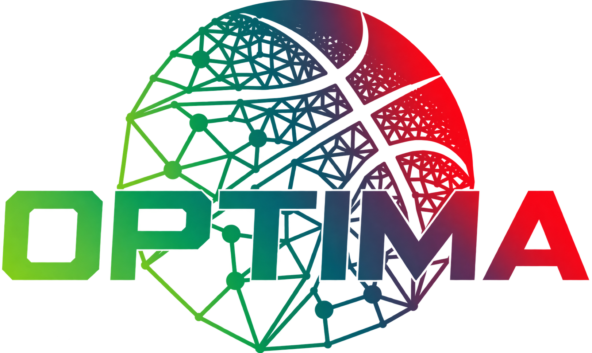

<!-- Splash image -->
<p align="center">
  
</p>

<h1 align="center">vid2osim</h1>

<p align="center">
  <em>A Python library for estimating OpenSim kinematics from diverse video sources.</em>
</p>

---

## Description

Library for markerless 3D kinematics estimation from diverse video sources, designed for low friction interfacing with [opensim-fitter](https://github.com/opensim-org/opensim-fitter).

## Installation
Install using `uv`:
```bash
git clone https://github.com/bmcinroe/optima-vid2osim.git
cd optima-vid2osim
uv sync
```

## Usage
Create the input and output directories:
```
mkdir -p input/cal output
```

Create `config.toml` in the root with the following entries:

```
[paths]
input_path = '/home/user/optima-vid2pose/input'
output_path = '/home/user/optima-vid2pose/output'

[seeds]
cam1 = [
    [x1, y1],
    [x2, y2],
    [x3, y3],
]
```
`[seeds]` contains uv coordinates for points on the subject in the first frame, used to initialize tracking. Include as many cameras and seed points as needed.

Place videos in `./input`, and calibration files in `./input/cal`. The calibration data should be stored in json files with names matching their cameras, e.g., `cam1_calibration.json`. The json must have the following structure:
```jsonc
{
  "0": {                          // frame index as a string key
    "intrinsic_matrix": [         // 3x3 camera matrix K
      [fx,  0.0, cx],
      [0.0, fy,  cy],
      [0.0, 0.0, 1.0]
    ],
    "extrinsic_matrix": [         // 3x4 [R | t]
      [r11, r12, r13, tx],
      [r21, r22, r23, ty],
      [r31, r32, r33, tz]
    ]
  },
  "1": { "intrinsic_matrix": [...], "extrinsic_matrix": [...] },
  ...
  "N-1": { "intrinsic_matrix": [...], "extrinsic_matrix": [...] }
}
```
Currently, each frame gets its own calibration to accomodate non-stationary cameras for broadcast video. Camera matrix estimation will be introduced in a near future update. With the `config.toml` created and input data in their appropriate directories, simply run:
```bash
python main.py
```
to generate 2D keypoints per video and the 3D pose reconstruction.

To save the complete output including MHR mesh, 3D keypoints, etc., include or uncomment `write_results_to_npz(ROOT / "output" / f"{cam}_results.npz", results)` inside the inference loop. A future update will integrate more robust monocular support.

## In Progress

Coming soon, in approximate order of priority:
- [ ] _Improved monocular support_
- [ ] _Improved multiview reconstruction_
- [ ] _Global camera-subject motion estimation with SLAM_
- [ ] _Integration with opensim-fitter_
- [ ] _Python build wheels_
- [ ] _Additional pose models_

## Acknowledgements

This project uses tools from the following libraries:
- [sam3](https://github.com/facebookresearch/sam3) — _segmentation and tracking_
- [sam-3d-body](https://github.com/facebookresearch/sam-3d-body) — _pose estimation_